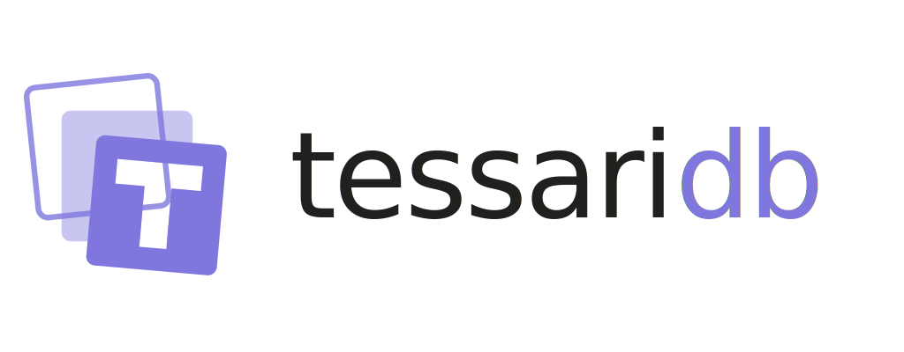
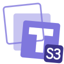

<div align="center">

<picture>
  <source media="(prefers-color-scheme: dark)" srcset="assets/tessaridb-lockup-white-1024.png">
  
</picture>

## The stack around the model, in one store.

Records, search, vectors, graphs, queues, topics, files, geometry and sealed secrets:
eleven engines over one transactional store, in one Rust binary.

[](https://github.com/tessaridb/tessaridb)
[](https://github.com/tessaridb/tessaridb-s3)
[](#clients)
[](https://hub.docker.com/r/tessaridb/tessaridb)

**[tessaridb.com](https://tessaridb.com) · [docs](https://docs.tessaridb.com) ·
[s3.tessaridb.com](https://s3.tessaridb.com)**

</div>

An AI product usually ends up running a database, a search engine, a vector index, a cache, a queue, an
event log and somewhere for files, with no transaction across any of them. TessariDB is one store that does
all of those jobs on the same records, under one snapshot, in one language. Not the fastest at any single
job; enough at all of them, and nothing to keep in step.

## Products

| | | |
|:-:|---|---|
|  | **[TessariDB](https://github.com/tessaridb/tessaridb)** | The database. Eleven engines, one transaction, followers and automatic failover. |
|  | **[TessariKV](https://github.com/tessaridb/tessarikv)** | The future heart of TessariDB: an embedded key-value storage engine in pure Rust, lock-free first. `in development` |
|  | **[TessariDB S3](https://github.com/tessaridb/tessaridb-s3)** | S3-compatible object storage in Rust. Metadata in TessariDB, bytes erasure-coded across nodes. `pre-alpha` |
|  | **[Agent Memory](https://tessaridb.com/agent-memory)** | Goals, plans, tasks and what each agent remembers, as queryable records. CLI, REST and MCP. `alpha` |

## Clients

Apache-2.0, all checked against one [protocol and conformance corpus](https://github.com/tessaridb/tessaridb-protocol):

- **[Rust](https://github.com/tessaridb/tessaridb-sdk-rust)**: `tessaridb-client`
- **[Python](https://github.com/tessaridb/tessaridb-sdk-python)**: `tessaridb-client`
- **[TypeScript](https://github.com/tessaridb/tessaridb-sdk-js)**: `@tessaridb/client`
- **[Go](https://github.com/tessaridb/tessaridb-sdk-go)**: `github.com/tessaridb/tessaridb-sdk-go`
- **[Kotlin](https://github.com/tessaridb/tessaridb-sdk-kotlin)**: `com.tessaridb:tessaridb-client`
- **[S3 SDK and CLI](https://github.com/tessaridb/tessaridb-s3-client)**: `tessaridb-s3-client`, for S3-compatible storage
- **[Agent plugins](https://github.com/tessaridb/tessaridb-agent-plugins)**: for Claude Code and Codex

## Start

```bash
docker run -d --name tessaridb \
  -p 9080:9080 -p 8000:8000 \
  -v tessaridb-data:/var/lib/tessaridb \
  -e TESSARIDB_INITIAL_USER=owner \
  -e TESSARIDB_INITIAL_PASSWORD='choose-a-real-one' \
  tessaridb/tessaridb
```

The console is at `http://localhost:8000`. Next: [the docs](https://docs.tessaridb.com).

Production use is free, commercial included (BUSL-1.1, each release converts to Apache-2.0 after four years).
Clients, protocol and TessariKV are Apache-2.0. hello@tessaridb.com

© 2026 [@boogvar](https://github.com/boogvar)
